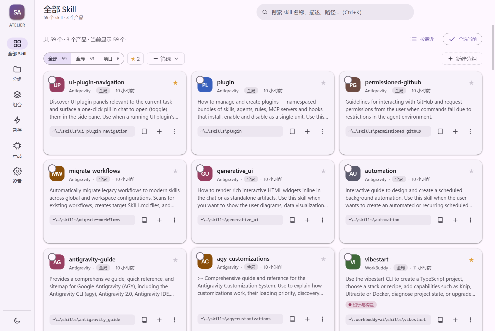
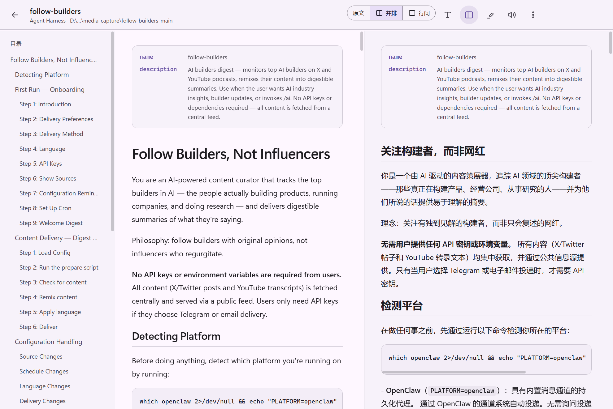
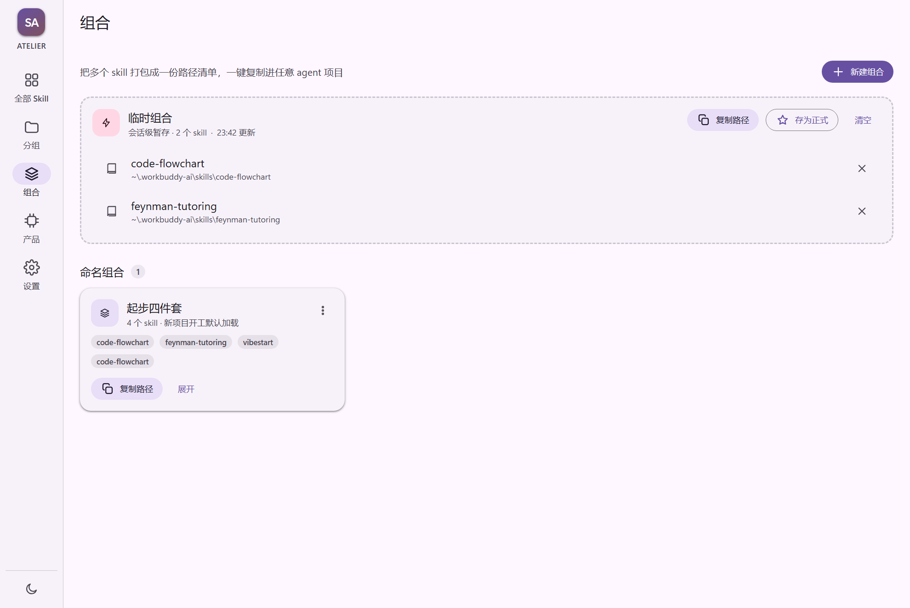

# Skill Atelier

> 本地 Skill 管理平台 —— 路径即入口，卡片即索引，授权即写权。

[](https://github.com/kelai061/skill-manage/releases)
[](https://www.electronjs.org/)
[](LICENSE)

**Skill Atelier** 是一个面向智能体（Agent）开发者的本地 Skill 管理工具。

给智能体产品一个启动路径，它自动把这个产品下所有 skill 找出来 —— 全局的、项目的，一并收进卡片墙。
浏览、分组、组合、精读、双语对照、授权改写，全部在一个窗口里完成；源文件全程只读。



---

## 下载

到 [Releases](https://github.com/kelai061/skill-manage/releases) 下载，两种形态任选：

| 形态 | 文件 | 说明 |
|---|---|---|
| **安装版**（推荐） | `SkillAtelier-Setup-1.0.2.exe` | 向导安装：**安装位置自选**，**桌面 / 开始菜单快捷方式自己勾** |
| 便携版 | `SkillAtelier-1.0.2.exe` | 单文件，放到任意目录双击即用，不写注册表 |
| 目录便携版 | `SkillAtelier-1.0.2-win-x64.zip` | 解压后运行 `SkillAtelier.exe`，数据在同目录 |

装完首次启动会扫描本机已装的智能体工具，勾选即完成初始化。

本地构建的可分发附件统一在 `release/current/`。仓库 Releases 中的版本以实际发布为准。

> **数据在哪里**
> - 便携版：exe 同目录的 `SkillAtelier-data\`，整个文件夹拷走即可换机器
> - 安装版：`%LOCALAPPDATA%\SkillAtelier\data\`（**卸载不会删**，重装后配置、译文、标记都还在）
>
> 分发包里不含任何个人信息、API Key 或开发者的索引数据。

---

## 它能做什么

| 能力 | 说明 |
|---|---|
| **自动收录** | 一个启动路径 → 产品 → 全局 skill / 项目 skill，深度 4 层，自动跳过临时目录 |
| **项目发现** | 从 Codex / ChatGPT 桌面版、WorkBuddy、Antigravity、Claude Code 等工具的本地元数据发现项目，0 个 skill 的项目也照样列出 |
| **卡片索引** | 搜索、筛选（全部 / 全局 / 项目 / 分组 / 收藏）、排序、收藏、五星评价 |
| **嵌套技能集** | 套娃的 skill 收成一张汇总卡，点开下钻，也可手动移出到顶层 |
| **组合** | 多选存为组合，一键复制路径清单；临时组合随手攒，满意了再存正式 |
| **双语对照** | 逐段翻译，并排 / 行间两种模式，滚动与选中双向同步 |
| **词级对齐** | 选中一个单词，对侧精确高亮对应译词，给出「源词 → 译词」 |
| **标记与朗读** | 四色高亮 + 备注；系统语音朗读选中片段或全文 |
| **附属预览** | 图片直接显示、代码带行号、Word 抽正文；不支持的格式说明原因 |
| **授权改写** | AI 只能出提案，逐行差异审阅通过才写入，写入前自动备份 |
| **交给智能体** | 顶栏「复制给智能体」= 软件目录 + 引导语，指向自动生成的 `skills.index.md` 清单 |

<table>
<tr>
<td width="50%"></td>
<td width="50%"></td>
</tr>
<tr>
<td><em>并排对照：滚动、选中、词级高亮三向同步</em></td>
<td><em>组合：把一组 skill 的路径一次交给智能体</em></td>
</tr>
</table>

---

## 快速开始

1. **登记产品**：侧边栏「产品」→ 添加产品 → 选智能体的启动程序或安装目录
2. **看卡片墙**：回到「全部 Skill」，这就是索引结果
3. **精读**：点卡片右下角「阅读」，可切「并排 / 行间」对照
4. **交给智能体**：右上角「复制给智能体」→ 粘贴到对话里

界面细节见应用内「设置 → 使用说明」。

---

## 设计原则

- **源文件只读**：扫描、阅读、翻译、标记全程不写 skill 目录
- **写权在你手上**：唯一会写入的是你亲手批准的 `SKILL.md` 改写，且先备份、再落盘
- **本地优先**：不注册账号、不上传索引、不收集遥测；只有翻译和更新检查会联网，且用的是你自己的接口
- **不臃肿**：Electron + 原生 ES Module + CSS，零前端框架、零打包器

---

## 技术栈

- **Electron 44** — 桌面壳，Windows x64
- **原生 ES Module + CSS** — 无构建步骤，直接跑源码
- **自定义 `app://` 协议** — 渲染进程 sandbox + contextIsolation，无 Node 能力
- **Material Design 3** — 色彩 / 字体 / 形状 / 高度 / 动效全部令牌化，明暗双主题
- **zlib（内置）** — 自解析 `.docx`，零外部依赖
- **Web Speech API** — 本地朗读，不联网

---

## 源码运行

```bash
git clone https://github.com/kelai061/skill-manage.git
cd skill-manage
npm install
npm run dev          # 开发模式（带 DevTools）
npm start            # 正常启动
npm test             # 临时样本 + 本机模拟 AI 接口，不读取个人配置
npm run pack         # 目录便携版 → release/build/portable/SkillAtelier/
npm run pack:release # ZIP → release/current/
npm run dist         # 安装版和单文件便携版 → release/current/
```

自动检测按安装身份区分产品：某些 `OpenAI.Codex` 商店包的窗口标题是 ChatGPT，会显示为「Codex / ChatGPT 桌面版」。独立 ChatGPT 安装单独识别；某个产品没有技能时保持为 0，不借用其他产品的技能。自定义安装位置仍可手动登记启动路径。

发行目录中，`current/` 只存当前版本附件与 SHA256 校验，`build/` 存中间构建，`archive/` 保留历史产物。运行数据不进入分发包。翻译测试使用固定样本文本验证对照、缓存与交互；实际译文质量取决于你配置的模型。

---

## 目录结构

```
main/       主进程：扫描、索引、AI、打包、更新
renderer/   渲染层：视图、组件、样式（无框架）
shared/     主进程与渲染层共用的纯函数（切句、对齐）
scripts/    启动、打包、图标、自动化验收
build/      图标等构建资源
site/       产品介绍页（静态 HTML）
```

---

## License

MIT © kelai061
